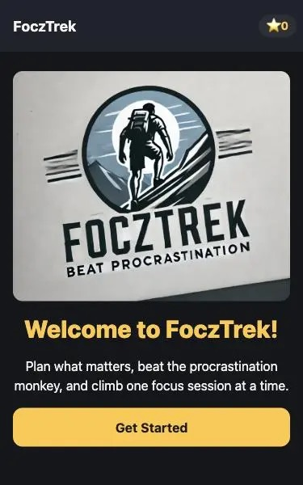
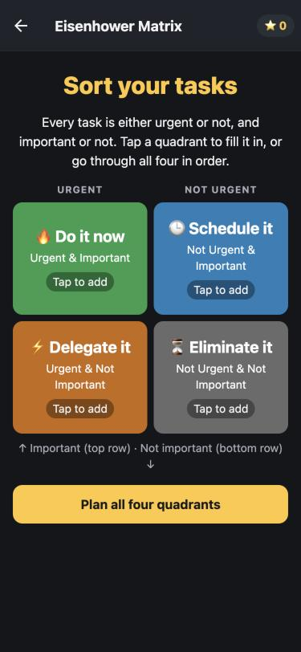
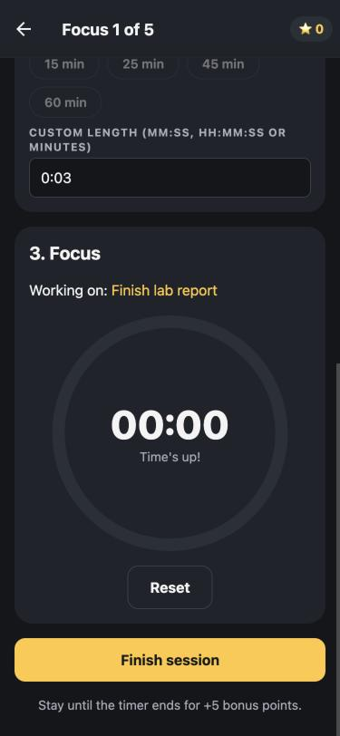
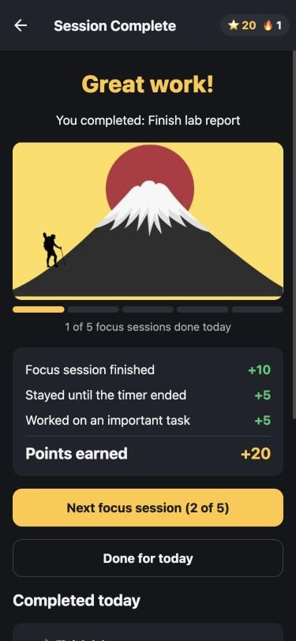

# FoczTrek 🏔️

**A student productivity app that turns "I should get stuff done" into a guided plan → focus → finish journey.**

`React Native` · `TypeScript` · `Expo SDK 51` · `Expo Router` · `React Native Web` · `AsyncStorage` · `Jest + React Native Testing Library`

| Welcome | Eisenhower Matrix | Focus timer | Session complete |
|---|---|---|---|
|  |  |  |  |

## What it does

1. **Prioritize.** Starts with the *Jar of Life* idea (big rocks first), then shows an interactive **Eisenhower Matrix**.
2. **Plan.** One form per quadrant (Do / Schedule / Delegate / Eliminate), with up to 5 tasks each and optional start and end times.
3. **Understand procrastination.** An illustrated walkthrough of the *Instant Gratification Monkey* and the *Panic Monster*.
4. **Focus.** Up to five **Pomodoro-style sessions** a day. Pick a task from your plan, set a length (presets or `MM:SS` / `HH:MM:SS`), then start, pause, resume or reset. An alarm plays at zero.
5. **Progress and gamification.** A hiker climbs the mountain with each session. You earn **points**, keep a **daily streak**, and move up through **ranks**.
6. **Persistence.** Points, streak, and today's plan are saved on the device, and a fresh plan starts each day.

### Points

| Action | Points |
|---|---|
| Finish a focus session | +10 |
| Stay until the timer reaches zero | +5 |
| Work on an important task (Do / Schedule quadrant) | +5 |
| Finish all 5 sessions in a day | +20 |

Ranks: Base Camp → Trailblazer (50) → Ridge Walker (150) → Summiteer (300) → Peak Master (600).

## Architecture

```
app/                         Expo Router: each file is a route
├── _layout.tsx              Root stack, AppStateProvider, splash until state is loaded
├── index.tsx                Welcome + stats
├── jar.tsx                  Jar of Life video
├── matrix.tsx               Interactive Eisenhower grid
├── plan/[quadrant].tsx      One dynamic route for all 4 quadrant forms
├── brain.tsx                Procrastination model
├── summary.tsx              Today's plan
├── focus/[session].tsx      One dynamic route for sessions 1–5
├── complete/[session].tsx   Points breakdown + what's left
└── summit.tsx               End of day
components/                  20 reusable UI components (QuadrantForm, TaskRow, FocusTimer, …)
context/AppStateContext.tsx  React Context + useReducer, persisted with AsyncStorage
lib/                         Pure, unit-tested logic: reducer, points, streaks, time parsing
hooks/useAlarm.ts            expo-av alarm
```

**Data flow:** screens read and update one typed `AppState` (plan, sessions, points, streak) through `useAppState()`. All state changes go through a pure reducer in `lib/appState.ts`, which keeps the business logic testable without rendering anything. The provider saves state to AsyncStorage after each change and restores it on launch.

**Performance:**
- `TaskRow` and `Chip` are memoized, and update callbacks are stable (`useCallback` / `useMemo`), so typing in one field re-renders only that row.
- The timer's once-per-second updates stay inside the countdown component's render prop, so the rest of the screen doesn't re-render every second.
- Illustrations are served as WebP at display resolution.

**Cross-platform:** `VideoEmbed.tsx` uses `react-native-webview` on iOS and Android, and `VideoEmbed.web.tsx` uses an `<iframe>`. Metro picks the right file for each platform. The layout uses a width-capped column and aspect-ratio images, so it works from phones to desktops.

## v2 refactor results (measured)

| | v1 | v2 | Change |
|---|---|---|---|
| Screen code | 20 files, 2,867 lines | 9 routes, 549 lines | **−81%** |
| Total app source (v2 includes persistence, points, streaks) | 2,867 lines | 2,099 lines | −27% |
| Reusable components | 0 | 20 | |
| Web JS bundle | 1,579 KB | 983 KB | **−38%** |
| Total web export | 7.4 MB | 1.8 MB | **−76%** |
| Image assets | 5.98 MB | 0.35 MB | −94% |
| Automated tests | 1 (template) | 38 | |

## Run it

```bash
npm install
npm run web          # browser
npx expo start       # Expo Go / iOS simulator / Android emulator
npm test             # 38 unit + component tests
npm run typecheck
```

Requires Node.js LTS.

## Credits

The procrastination illustrations are based on Tim Urban's *Wait But Why* / TED talk "Inside the mind of a master procrastinator". The Jar of Life video is embedded from YouTube.
